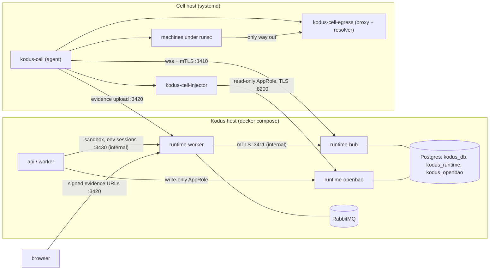

# Kody Runtime on self-hosted

Kody Runtime runs a pull request's system for real: it boots the base and the PR side in isolated machines, replays
probes against both, and reviews what changed in behaviour. It also gives Kody and custom agents a code sandbox. This
guide installs it next to a [Docker Compose install of Kodus](compose.md).

It has two halves:

- **Control plane**, on the Kodus host, in Compose: the hub (the cells' endpoint), the runtime-worker (Runs, setups,
  sandboxes), and OpenBao (the org secrets). They use the Postgres and RabbitMQ Kodus already runs.
- **Cells**, on one or more Linux hosts (the Kodus host itself works): the cell agent, its egress proxy and resolver,
  its credential injector and its reaper, as systemd units. Machines run under gVisor (`runsc`) in the host's Docker.



## Status: images that do not exist yet

No product release carries the Runtime yet and no cell release has run, so **no registry holds these images**
(`runtime/images.lock`, column `status`):

| Component | What it is | Where it will be published | Today |
|---|---|---|---|
| `hub`, `worker` | Control plane (`docker-bake.hcl` targets `runtime-hub`, `runtime-worker`) | `ghcr.io/kodustech/kodus-runtime-hub`, `-worker` | Built by no workflow |
| `cell` | Every cell binary, distroless (`apps/runtime-cell/Dockerfile`) | `ghcr.io/kodustech/kodus-runtime-cell` | Release workflow written, never run |
| `builder` | Rootless BuildKit with the gVisor overlay fix; digest pinned in the cell | `ghcr.io/kodustech/kodus-runtime-builder` | Digest known (`f4c8f1e1…`), not pushed |
| `sandbox` | Code sandbox tool image with the guest agent | not decided | Built by no workflow |
| `browser` | Browser runner for browser probes | not decided | Built by no workflow |
| `microvm-kit` | Firecracker, jailer, guest kernel, rootfs | not decided | Not built (phase P2) |

The third-party images are upstream, unmodified and pinned by digest: OpenBao 2.7.2, `registry:3`, Alpine 3.20 (the
holder and the egress/injector containers) and BusyBox 1.36.

### Pointing at local builds meanwhile

Build from a `kodus-ai` checkout that has `apps/runtime` (branch `kody-runtime/base` today), then name each image with
`KODUS_RUNTIME_<COMPONENT>_IMAGE` and use the release `unreleased`:

```bash
# in kodus-ai
docker buildx bake runtime-hub runtime-worker --load                     # kodus-runtime-hub:local, kodus-runtime-worker:local
docker buildx build --load -t kodus-runtime-cell:local -f apps/runtime-cell/Dockerfile apps/runtime-cell
docker buildx bake runtime-sandbox --set runtime-sandbox.platform=linux/$(uname -m | sed 's/x86_64/amd64/;s/aarch64/arm64/') --load
docker buildx bake runtime-builder --set runtime-builder.platform=linux/amd64 --load   # or push it to your registry

# in kodus-installer, control plane
export KODUS_RUNTIME_HUB_IMAGE=kodus-runtime-hub:local KODUS_RUNTIME_WORKER_IMAGE=kodus-runtime-worker:local
sudo -E scripts/runtime/install.sh --release unreleased --cell-profile docker-gvisor --hub-host <host>

# on the cell host (the images must be in that host's Docker)
export KODUS_RUNTIME_CELL_IMAGE=kodus-runtime-cell:local KODUS_RUNTIME_SANDBOX_IMAGE=kodus-runtime-sandbox:local \
       KODUS_RUNTIME_BUILDER_IMAGE=<your registry>/kodus-runtime-builder@sha256:<digest>
sudo -E scripts/runtime/cell-host.sh install --profile docker-gvisor --bundle ./cell-host --release unreleased --token-file token
```

The product images must also carry the Runtime (its API routes and migrations): until a product release does, build
`api`, `worker` and `web` from the same checkout and set `KODUS_REGISTRY`/`IMAGE_TAG` to them. The builder image's
digest must be the one the cell pins (`cmd/cell/config.go`); a local `docker build` gives another digest, so either
push the reproducible build to a registry of your own under that digest or pass the digest you built with
`KODUS_RUNTIME_BUILDER_IMAGE`.

## Profiles

Chosen at install time (`--cell-profile`, `--profile`); `cell-host.sh check` runs the profile's checks before a cell
starts and names every requirement that is missing.

| Profile | Install | Host needs | Extra artifacts |
|---|---|---|---|
| `docker-gvisor` | `cell-host.sh install` | Linux, rootful Docker with `runsc` registered (installed for you), systemd | Builder image |
| `docker-firecracker` | checks only | `/dev/kvm`, cgroup v2, XFS with reflink or an LVM thin pool | microVM kit; the `firecracker` backend (phase P2: the cell refuses it today) |
| `kubernetes` | checks only | A gVisor or Kata RuntimeClass (or a KVM node pool) | The chart does not run a cell yet; see [Kubernetes](#kubernetes) |
| any, air-gapped | `bundle-export.sh` / `bundle-import.sh` | A registry you run | One OCI layout with every image, same digests |

OpenBao ships in every profile.

## Host requirements

### Kodus host (control plane)

- The Compose install of Kodus, pinned to a release (`IMAGE_TAG`, not `latest`), with Docker Compose v2.
- Ports: `3410/tcp` reachable from every cell host (the hub; mTLS after enrollment), `3420/tcp` reachable from cell
  hosts and from users' browsers (evidence; put it behind your TLS proxy), `8200/tcp` reachable from cell hosts
  (OpenBao, TLS). `3411` and `3430` stay on the Compose network.
- About 1 GB of memory for the hub, the runtime-worker and OpenBao together.

### Cell host, `docker-gvisor`

| Requirement | Minimum | Recommended | Checked |
|---|---|---|---|
| Linux distribution | any with systemd | Ubuntu 22.04 or 24.04 (the dev cell runs Ubuntu, aarch64) | systemd present |
| Architecture | x86_64 or aarch64 | | yes |
| Kernel | 4.14.77 (gVisor's minimum) | 5.10 or later | yes |
| Docker Engine | 24.0, rootful | 25.0 or later (API 1.44: faster boots and resets) | yes, and rootless is refused |
| gVisor | `runsc` registered as runtime `runsc` | installed by `cell-host.sh` (release pinned in `runtime/gvisor.tsv`) | yes |
| cgroup | v1 works | v2 (per-claim aggregate limits) | warning |
| Disk under `/var/lib/kodus-cell` | 20 GB free | 100 GB on XFS or btrfs (reflink: a PR's build reads the environment's build state through a clone; on ext4 it goes through overlay and most Node builds run twice) | yes |
| Memory | 6 GB | 16 GB for more than one claim at a time | yes |
| Tools | `curl`, `openssl`, `tar`, `bzip2`, `sha512sum` | | yes |
| Network | out to the hub (3410), OpenBao (8200), the evidence server (3420), the Git API, and the hosts on the egress allow-list | | the hub is checked |

`-gvisor-container-disk` (a cap on each machine's writable layer) needs overlay2 on XFS with `pquota`, btrfs or zfs;
it is off by default.

### Cell host, `docker-firecracker`

Everything above except gVisor, plus `/dev/kvm` readable and writable by root (bare metal, or an instance type with
nested virtualization), cgroup v2, kernel 5.10 or later, and XFS with `reflink=1` under the work directory or an LVM
thin pool (`--thin-pool vg/pool`). The check also fails until a cell release ships the `firecracker` backend and its
microVM kit.

## Install

### 1. Control plane

On the Kodus host, from this repository, after `scripts/install.sh` brought Kodus up:

```bash
sudo scripts/runtime/install.sh --cell-profile docker-gvisor --hub-host runtime.example.com \
    --openbao-host 10.0.0.5 --evidence-url https://runtime-evidence.example.com
```

- `--hub-host`: the name or address cell hosts use for the hub; it goes in the hub's certificate.
- `--openbao-host`: where cell hosts reach OpenBao (default: the hub host); goes in OpenBao's certificate. Set
  `--openbao-bind` to the interface that address is on (default `127.0.0.1`: only this host). For a cell on the Kodus
  host itself use the Docker bridge address, e.g. `--openbao-host 172.17.0.1 --openbao-bind 172.17.0.1`.
- `--evidence-url`: the public URL of the evidence server (default `http://<hub-host>:3420`).
- `--git-api`: the Git API cells download tarballs from (default `https://api.github.com`; GitHub Enterprise:
  `https://<host>/api/v3`). It must be the same on every cell.
- `--injector-org <organizationId>`: narrows the injector's OpenBao policy to one organization. Only before OpenBao's
  first start: its self-initialization runs once.
- `--sandbox-provider runtime`: sends the review's code sandbox to the cell (`SANDBOX_PROVIDER=runtime` for the API and
  the worker). Leave it for after the smoke check; until then `.env`'s choice stays.

What it does, in this order: pins the images for the release (`runtime/compatibility.tsv`, `runtime/images.lock`),
generates the secrets and certificates (`scripts/runtime/generate.sh`), creates the Postgres roles and databases
(`runtime-init`), the RabbitMQ user `kodus_runtime`, starts OpenBao, the hub (which applies the Runtime migrations),
recreates the API and the worker with the Runtime env (the API applies the product migrations), applies the read
grants once the tables exist, and starts the runtime-worker.

From then on `scripts/install.sh` keeps the Runtime env on the API and the worker, and
`scripts/runtime/compose.sh` is `docker compose` over both files (`compose.sh ps`, `compose.sh logs -f runtime-hub`).

### 2. A registration token

Single use, valid 15 minutes, bound to your organization and the topology `self_hosted`. The web app has no screen for
it yet; as the org owner:

```bash
scripts/runtime/cell-token.sh --api-url https://api.example.com --email owner@example.com --out token
```

(or `KODUS_ACCESS_TOKEN=<owner access token>` instead of `--email`).

### 3. Cell host

Copy `runtime/state/cell-host/` from the Kodus host to the cell host privately: it holds the injector's OpenBao
credential (no CA key). Clone this repository there too, then:

```bash
sudo scripts/runtime/cell-host.sh check --profile docker-gvisor --bundle ./cell-host     # optional: what is missing
sudo scripts/runtime/cell-host.sh install --profile docker-gvisor --bundle ./cell-host --token-file token
```

`install` checks the host, installs gVisor's `runsc` and `containerd-shim-runsc-v1` from the pinned release after
checking its SHA-512 (and the published one), registers `runsc` with Docker (`runsc install`, then a Docker reload, not
a restart), copies the cell release's binaries out of the cell image into `/opt/kodus-cell/releases/<release>`,
builds the observer image from them, enrolls the cell (`cell register -topology self_hosted`, token in the
environment, never on the command line), creates the cell-local CA and the egress, injector and observer certificates,
writes `/etc/kodus/cell/cell.yaml` and `cell.env`, and enables these units:

| Unit | What |
|---|---|
| `kodus-cell-injector.service` | Credential injector, in a container on Docker's default bridge, control port `127.0.0.1:9445` |
| `kodus-cell-egress.service` | Egress proxy, resolver (the same process: the proxy accepts exactly the addresses the resolver handed out) and the registry/Go mirror; control port `127.0.0.1:9443` |
| `kodus-cell.service` | The agent, on the host as root; bound to the egress (claim networks are joined to that container) |
| `kodus-cell-reaper.timer` | One reaper pass a minute: destroys every machine past its hard expiry, whatever anyone renews |
| `kodus-cell.target` | The three services, restarted in order |

Options: `--egress-allow` (the hosts every claim may reach; default the image registry, npm and the Debian, Ubuntu and
Alpine mirrors), `--upstream-dns` (default `1.1.1.1:53`; set your resolver on a closed network), `--sandbox-pool N`
(blank sandboxes kept ready, counted in the memory admission), `--workdir`, `--gvisor-archive` (offline),
`--dry-run` (prints what would change Docker, systemd and the enrollment instead of doing it).

## Verify

```bash
scripts/runtime/smoke.sh --org <organizationId>
```

It checks that OpenBao is unsealed, the hub healthy, the runtime-worker running and a cell connected; then it opens a
code sandbox on a cell through the runtime-worker's listener, with the same signed requests the product sends, runs a
command in it, reaches a host on the sandbox's allow-list (`github.com`), and is refused a host off it
(`example.com`). The organization id is `SELECT uuid FROM organizations` in the product database. On the cell host the
refusal is in `journalctl -u kodus-cell-egress`.

Then, in the product: the Runtime settings page lists the cell; `@kody runtime` on a test PR of a connected repository
runs.

## Upgrade

```bash
scripts/runtime/upgrade.sh --release <new product release> --backup-dir /backups/runtime-$(date +%F) --unseal-key-out /secure/unseal-$(date +%F).key
```

It waits for the claims in flight to end, stops the runtime-worker, backs up, then re-runs `install.sh`: the hub first
(Runtime migrations, additive), the API (product migrations), the grants, the worker last. Then upgrade each cell to a
cell release of the same row of `runtime/compatibility.tsv`:

```bash
sudo scripts/runtime/cell-host.sh upgrade --release <cell release>
```

The hub always goes first: a newer cell's hello carries fields an older hub refuses. `cell-host.sh rollback` puts the
previous cell release back (with the images it ran with); `install.sh --release <previous>` rolls the control plane
back (the Runtime's migrations only add tables).

## Backup and restore

```bash
scripts/runtime/backup.sh --out /backups/runtime --unseal-key-out /secure/openbao-unseal.key
```

- `kodus_runtime.dump`, `kodus_openbao.dump` (every org secret, encrypted under the unseal key), `runtime-state.tar.gz`
  (passwords, CAs and keys, AppRole ids, settings), `MANIFEST`.
- The **unseal key** is written apart and the script refuses to put it inside `--out`. Keep it where the dumps are not:
  without it the vault dump cannot be read; with both, anyone can.
- The product database (and its `runtime_secrets` metadata) is the product's own backup. `--with-evidence` adds the
  evidence volume (30 days of screenshots and logs).
- Cell hosts: `cell-host.sh backup --out cell.tgz` saves the identity, local PKI, config and the bake catalog
  (`/var/lib/kodus-cell/state/bakes`). Re-registering a cell instead makes a new cell.

Restore after the product database: `scripts/runtime/restore.sh --from /backups/runtime --unseal-key
/secure/openbao-unseal.key`, then `scripts/runtime/install.sh`.

## Uninstall

- Control plane: `scripts/runtime/uninstall.sh` removes the services and recreates the API and the worker without the
  Runtime; data stays. `--purge-data --i-have-a-backup` also drops `kodus_runtime`, `kodus_openbao`, the roles, the
  RabbitMQ user, the evidence volume and `runtime/state`.
- Cell host: `sudo scripts/runtime/cell-host.sh uninstall --purge` (units, containers and networks of the cell,
  `/etc/kodus/cell`, `/opt/kodus-cell`, `/var/lib/kodus-cell`; `--remove-runsc` also unregisters gVisor). Then revoke
  the cell in Kodus: `POST /runtime/cells/<cell id>/revoke` as the org owner.

## Offline bundle

On a connected machine:

```bash
scripts/runtime/bundle-export.sh --release <product release> --out kodus-runtime-bundle
```

One OCI layout (`oci/`) with every image of the release and its cell release, each copied with all its platforms and
its digest checked; `files/gvisor/` with the gVisor archives; `runtime/` with the tables; `SHA256SUMS`. skopeo
(Apache-2.0) runs as a container. Inside the closed network:

```bash
REGISTRY_AUTH_FILE=auth.json scripts/runtime/bundle-import.sh --bundle kodus-runtime-bundle --registry registry.internal/kodus
export KODUS_RUNTIME_REGISTRY=registry.internal/kodus     # on the control plane and every cell host
sudo -E scripts/runtime/cell-host.sh install ... --gvisor-archive kodus-runtime-bundle/files/gvisor/<release>/$(uname -m)/gvisor.tar.bz2 --upstream-dns <your resolver>
```

Each image lands at `<registry>/<its source repository>` with the same digest; the import verifies every one. The
Runtime images must be published first; the bundle refuses an unpublished one.

## Kubernetes

No cell runs on Kubernetes yet: `kodus-ai` `apps/runtime-cell/deploy/chart/runtime-cell` renders only the reaper
CronJob, the RuntimeClass, an admission policy and RBAC, and `cmd/cell` cannot select the `k8s-sandbox` driver. A
Kubernetes customer runs the control plane as usual and cells on a Docker host (`docker-gvisor`). What is ready for when
the chart runs cells:

- `runtime/kubernetes/runtimeclass-gvisor.yaml` (handler `runsc`) and `runtimeclass-kata.yaml` (handler `kata-qemu`;
  `kata-clh`, `kata-fc` for other hypervisors), each scheduled on a labelled node pool. Managed offerings create their
  own class (GKE Sandbox: `gvisor`; AKS Pod Sandboxing has its own name): use that name and skip the file, and keep the
  chart from creating a second one.
- `runtime/kubernetes/values-runtime-cell-gvisor.yaml` and `values-runtime-cell-kata.yaml` for that chart (images by
  digest only).
- `cell-host.sh check --profile kubernetes [--runtime-class <name>]` checks `kubectl`, the cluster and the class.

## Network and permissions reference

| Port | Service | Who connects | TLS |
|---|---|---|---|
| 3410 | runtime-hub | cells: `/cells/register` (token), `/cells` (WebSocket), `/cells/renew` | Runtime CA; client certificates after enrollment |
| 3411 | runtime-hub, internal | runtime-worker only (compose network) | mTLS, worker CA, CN `runtime-worker` |
| 3420 | runtime-worker evidence | cells (upload), browsers (signed URLs) | your proxy |
| 3430 | runtime-worker sandbox/env sessions | API, worker (compose network) | HMAC-signed requests |
| 8200 | runtime-openbao | API (compose network), cell injectors | OpenBao CA |
| 9443, 9445, 9466 | cell egress, injector, agent metrics | the agent, on the cell host's loopback | cell-local CA |

RabbitMQ user `kodus_runtime` on the product vhost (set by `install.sh` on the bundled broker; on an external broker,
create it with these): configure `^(workflow\.jobs\.runtime_(run|control)\.queue|amq\.gen-.*)$`, write
`^(workflow\.exchange|workflow\.exchange\.runtime_run_retry|workflow\.jobs\.runtime_(run|control)\.queue|amq\.gen-.*)$`,
read `^(workflow\.exchange|workflow\.jobs\.runtime_(run|control)\.queue|amq\.gen-.*)$`, and on `workflow.exchange` the
topic permissions write `^workflow\.jobs\.created\.RUNTIME_PUBLISH$`, read `^workflow\.jobs\.(\*|created)\.RUNTIME_(RUN|CONTROL)$`.

Postgres roles (`runtime/sql/runtime-roles.sql`): `kodus_runtime` owns `kodus_runtime`; `kodus_runtime_reader` reads
the Runtime tables the product reads; `kodus_runtime_secrets_reader` reads only `organization_id, secret_id, name,
hosts` of `runtime_secrets`; `openbao` owns `kodus_openbao`. On an external Postgres the admin in `.env` needs
`CREATEROLE` and `CREATEDB`.

## Files

| Path | Secret | What |
|---|---|---|
| `runtime/state/` (gitignored, 0600, uid 1000) | yes | Everything generated: `secrets.env`, env files, `pki/`, `openbao/`, `cell-host/` |
| `runtime/state/openbao/server/unseal.key` | the vault | OpenBao's static unseal key |
| `runtime/compatibility.tsv`, `runtime/images.lock`, `runtime/gvisor.tsv` | no | What fits what, by digest |
| `runtime/openbao/`, `runtime/sql/` | no | Vendored from `kodus-ai` (`scripts/runtime/sync-from-kodus-ai.sh --check`) |
| `/etc/kodus/cell/` on a cell host | yes | Identity from the hub, cell-local CA, config |

## Troubleshoot

| Symptom | Cause | Fix |
|---|---|---|
| `install.sh`: the 'hub' image … is not published | No Runtime release yet | [Local builds](#pointing-at-local-builds-meanwhile) |
| `install.sh`: pin the product release | `IMAGE_TAG=latest` | Set a release listed in `runtime/compatibility.tsv` |
| `runtime-hub` restarting: `refused in the production image` | A dev switch reached the production image | Remove it; the hub takes no `RUNTIME_DEV_*` or plaintext mode |
| `runtime-openbao` unhealthy: `password authentication failed for user "openbao"` | `runtime-init` did not run, or `runtime/state` from another install | `RUNTIME_INIT_MODE=roles scripts/runtime/compose.sh run --rm runtime-init` |
| `runtime-openbao` exits: storage cannot be decrypted | Wrong `unseal.key` for this database | Restore the key that matches the dump |
| `cell-host.sh check`: runsc is not registered | gVisor missing | `cell-host.sh install` installs it |
| `cell-host.sh check`: `/dev/kvm` is missing | No KVM on this host | Use `docker-gvisor`, or a bare-metal / nested-virtualization host |
| `cell register`: `registration_refused` `expired` / `unknown_or_used` | Token older than 15 minutes, or used | A new token |
| `cell register`: `topology_mismatch` | Token made for `hybrid` | A `self_hosted` token (`cell-token.sh` default) |
| `cell register`: TLS error | `--hub-host` not in the hub certificate, or the wrong CA | `generate.sh --hub-host <name the cell uses> --rotate-certs`, then restart the hub |
| `journalctl -u kodus-cell`: `the runsc runtime is not installed in this Docker` | Docker restarted without its daemon.json runtimes | `runsc install` and `systemctl reload docker` |
| The cell connects but takes no work | It waits for both alert feeds (egress, injector) | `systemctl status kodus-cell-egress kodus-cell-injector` |
| Sandbox smoke: `sandbox_off` | `RUNTIME_SANDBOX_URL` or the sealing key missing on the product | Re-run `install.sh` |
| Evidence links do not open | `--evidence-url` not reachable from browsers | Publish 3420 behind your proxy and set `--evidence-url` |
| Builds fail on `RUN apt-get` | The package host is not on the allow-list | `--egress-allow` with your mirrors, then `cell-host.sh upgrade` |
